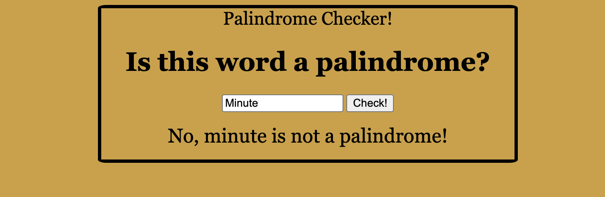

# Palindrome Checker

Type in a word and find out if it reads the same forwards and backwards — with the check done on the server.

Live demo: https://palindrome-finder.onrender.com




## What it does

- Type a word and click Check.
- The server checks it (`GET /check?word=…`) by comparing letters from the front and the back, ignoring case.
- The page answers "Yes, _word_ is a palindrome!" or "No, _word_ is not a palindrome!"

## Tech stack

- Node.js — plain `http` and `fs` modules, no framework
- HTML, CSS, vanilla JavaScript
- figlet (for the 404 page)

## How to run it

```bash
npm install
node server.js
```

Open http://localhost:8000. There is no `npm start` script in this repo — run `node server.js` directly.

## Project structure

```
server.js            - Node http server (port 8000), /check endpoint, serves the page
index.html           - the checker page (input, Check button, result)
js/main.js           - sends your word to /check and shows the answer
css/style.css        - page styling
package.json         - dependencies (figlet)
```

---

Thay Brown — thaybrown22@gmail.com · https://thaythecoder.netlify.app · https://github.com/tbrown320 · https://www.linkedin.com/in/thaybrown
