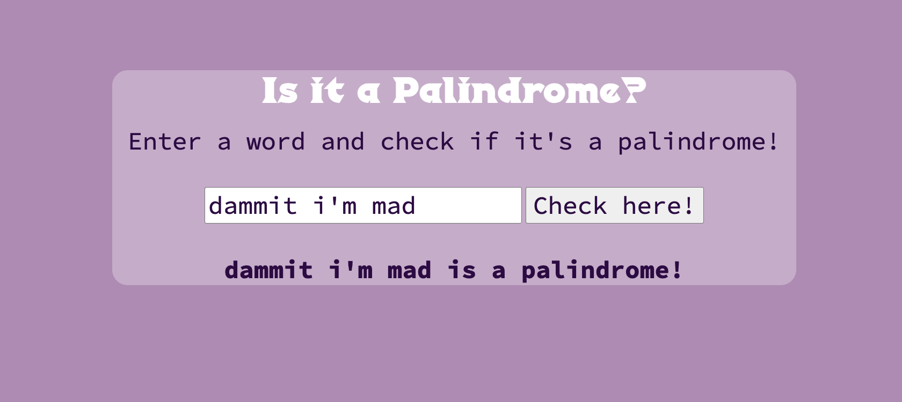

# 🔁 Palindrome Checker

A palindrome checker that runs in the browser. Type a word or phrase into the input box and it tells you whether it reads the same forwards or backwards.

### Project Description

This project is a small web app that checks whether a string is a palindrome. It takes whatever the user types into the input box, normalizes it by lowercasing and stripping out spaces and punctuation, reverses it, and compares the two — then writes the verdict to the page. The styling is clean and high-contrast so the answer is readable at a glance.

### Live Link
Use the link in the About section of this repo or simply [**click here**](https://node-palindrome-h4ez.onrender.com/)




### Features:

- **Palindrome check** — reports whether the input reads the same forwards and backwards.
- **Normalization** — ignores case, spaces, and punctuation, so `A man, a plan, a canal: Panama` becomes `amanaplanacanalpanama` and counts as a palindrome.
- **Result displayed on the page** — the verdict appears in the result area rather than in an alert or the console.

### Tech Used:

- **Frontend:** HTML, CSS, JavaScript 
- **Browser APIs:** `document.querySelector`, `addEventListener`
- **String methods:** `toLowerCase()`, `replace()`, `split()`, `reverse()`, `join()`
- **Hosting:** Render

### Things I Learned:

- CSS layout:
  - How flexbox centers the input and result without hand-positioning anything.
- JavaScript fundamentals:
  - How to reverse a string in JavaScript — there's no built-in `reverse()` for strings, so you have to turn the string into an array by using `split("")` → `reverse()` → `join("")`.
  -  Learned to normalize input with `toLowerCase()` and a regex in `replace()`, and why stripping punctuation matters for phrases rather than single words.

### How to Use:

1. Naviate to the [live link](https://node-palindrome-h4ez.onrender.com/) hosted on Render.

2. Type in a word or phrase and hit the `Check Here` button to get your result!

3. Or make this project your own! 
- Step 1. Clone this repository:
```bash
git clone https://github.com/priscilla-ruilova/node-palindrome.git
```

- Step 2. Navigate to the project:
```bash
cd node-palindrome
```

- Step 3. Run this command in the terminal to install dependencies `npm install` 

- Step 4. Run this command to start your app `node server.js`  

- Step 5. Edit the styling however you want!

## Happy Coding!

