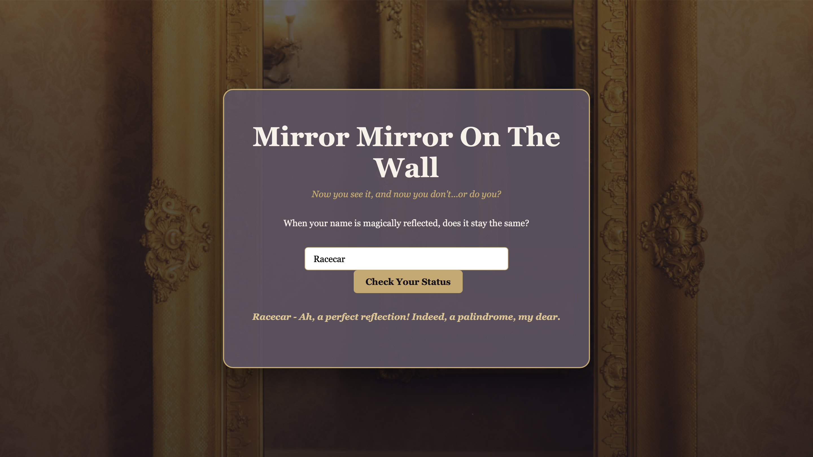

# Mirror Mirror On The Wall

A server-side palindrome checker with a fairytale-inspired twist.

Enter a word or name and the application checks whether it reads the same forwards and backwards. The palindrome validation happens on the Node.js server, with the result sent back to the browser and displayed on the page.

## How to Use

1. Enter a word or name into the input field.
2. Click **Check Your Status**.
3. The server checks whether the entered text is a palindrome.
4. The result appears beneath the button.

For example, `racecar` and `Ada` are recognized as palindromes, while a word like `hello` is not.

## How It Works

When the button is clicked, the browser sends the entered text to the server through an API request.

The server converts the text to lowercase, reverses it using `split()`, `reverse()`, and `join()`, and compares the reversed version with the original.

It then sends a JSON response back to the browser indicating whether the text is a palindrome. JavaScript uses that response to display the result on the page.

## Built With

- HTML
- CSS
- JavaScript
- Node.js
- Node HTTP module
- Node File System module
- Fetch API

## Run Locally

Install the project dependencies:

npm install

Start the server:

node js/server.js

Then open:

http://localhost:8000

## Future Improvements

- Allow phrases and sentences by ignoring spaces and punctuation when checking for palindromes.
- Add a visual “reflection” that displays the reversed version of the entered word beside the original.
- Add a subtle visual effect when the result is revealed.
