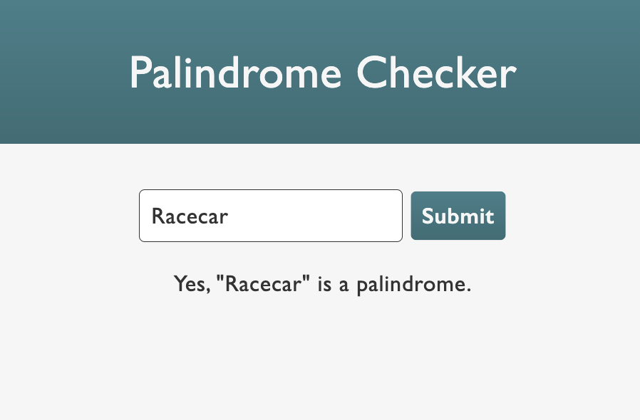

# Palindrome Checker

> Use this app to check if a word or phrase is a palindrome.

> 

## Table of Contents

1. [Tech Stack](#tech-stack)
1. [Development](#development)
   1. [Build and Serve App](#build-and-serve-app)
1. [View Application](#view-application)

## Tech Stack

- **HTML**
- **CSS**
- **JavaScript**
- **Render**

## Development

#### Build and Serve App

From root directory

```
$ node server.js
```

## View Application

For development, in your browser, navigate to

```sh
http://localhost:8000
```

View the latest deploy at: https://node-palindrome-fbm0.onrender.com
