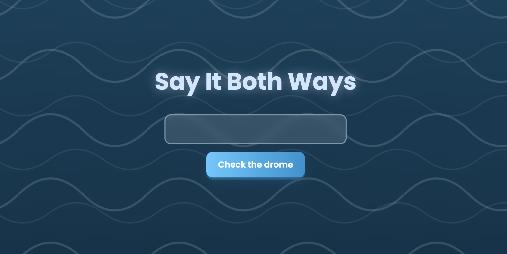

# 💧 Say It Both Ways — Palindrome Checker

A simple word app that checks if your input reads the same **forward and backward**.  
When it is, the reflection appears like words gliding over still water.

[Link to project](replace with your live demo link) 

---

## How It’s Made
**Tech used:** HTML, CSS, JavaScript, Node.js  

The app uses a small **Node.js server** to check for palindromes and return the result.  
On the front end, a **calm pond-inspired design** features subtle ripples, glassy elements, and reflective text that only appears for palindromes.

---

## Optimizations
- Added input validation for empty entries.  
- Reflection only activates for valid palindromes.  
- Background animation no longer blocks user interaction.  

---

## Lessons Learned
- Built a simple Node API and connected it with a front-end fetch request.  
- Used `-webkit-box-reflect` for conditional mirror effects.  
- Enhanced user feedback with subtle animation and color contrast.
