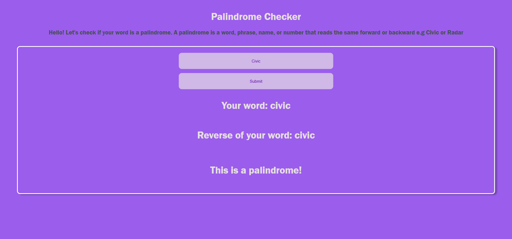

# Palindrome Checker

# Description
This website enables users to look up if the word they entered is a palindrome e.g civic or radar

## How It's Made:
Tech used: 
- HTML
- CSS
- JavaScript
- Node.js
- API

## How to use:
To use this word checker, follow these steps:
- Clone the repository: git clone https://github.com/WinnieYuDev/node-palindrome-checker.git
- Navigate to the app directory in terminal: cd app
- Install module dependencies in terminal: npm install
- Run the server by pasting this into the terminal: node server.js
- Open your browser and launch link http://localhost:3000/

## Lessons Learned:
- How to create local servers
- How to make an API with JSON objects
- What a palindrome is
- How to fetch objects from API to show up in client side via InnerText
- Use of JS methods e.g join(), reverse(), string()

